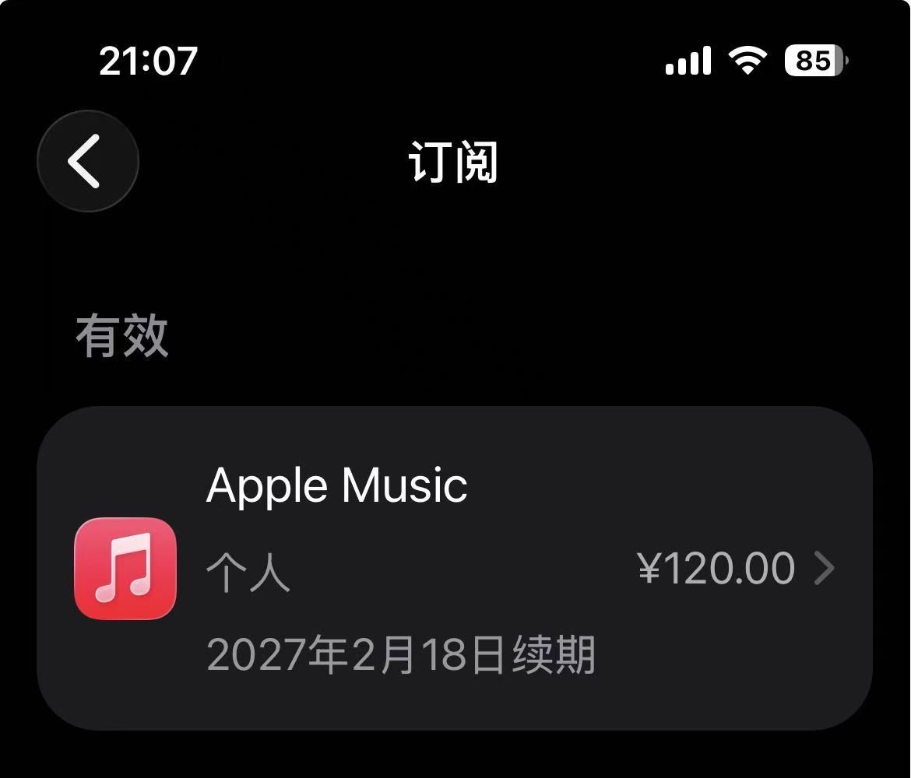

# A Year On Apple Music

> I've been using Apple Music for many years, and I've never stopped subscribing.
> 
> I've tried a lot of other music apps, but I always came back to Apple Music. Maybe it doesn't have the most features, but I love how simple and quiet it feels.

_sorted by my play counts_

### Baby - Dijon

- At first, this album felt completely chaotic to me. It was like taking a few perfectly made pieces of clothing, cutting them into pieces, and somehow stitching them back together into something new.
- But after listening to it again and again, I started to taste the strange mix of madness, excitement, obsession, and restraint hidden inside it.
- The feeling is almost like losing yourself after a few drinks — everything becomes blurry, emotional, and overwhelming. It feels a little unreal, almost like being carried away by the moment.
- I honestly don't even know how to describe it properly. Maybe that's the point. I just have a feeling that you'll love it.

### Anti-People Pleaser - Chace

- Modern electronic synths mixed with '80s-style rhythms.
- It's surprisingly suitable for people who don't have much energy. The album is energetic, catchy, and easy to get into.
- I also experienced it live — not bad at all.

### Ruby - JENNIE

- Very popular, very cool, and full of charm.
- For my 2nd comment: see the first one.
- For my 3rd comment: trust me, just see the first one.

### Algorithm - Lucky Daye

- A sleepless night, a random discovery, and suddenly it was time to go to work.
- This album feels like R&B on the edge of losing control — emotional, unpredictable, and a little dangerous.
- How did I discover Lucky Daye? I first heard him through his collaboration with Babyface on “Shoulda”.

### The Day - Babyface

- Romantic, relaxing, and simply comfortable.
- A collection of different sides of Babyface, showing how versatile he can be.
- This isn't an album I discovered this year. I've been listening to it for a long time, and it's still one of those records I keep coming back to.

### Through Thick & Thin - Gen Neo

- A pretty interesting EP from a pretty interesting artist.
- If you have some free time, maybe give it a listen.