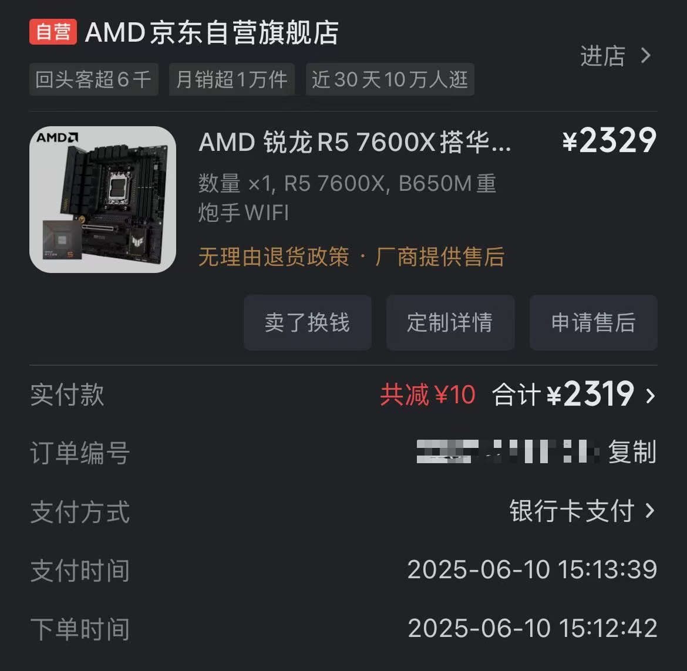

# A Year on Steam

I put together a PC last year for multiplayer gaming with friends.

> I've played a lot of great `co-op` games since then, and here are my top picks from this past year

_I've sorted them by the time I started playing._

### Split Fiction

- The character I played as is `Zoe Foster`, a fantasy writer who is often a little lost in her own world. I found that really charming and fun.
- The way this game is controlled is so creative and imaginative. Visually, it feels like you've stepped into a storybook — the kind of thing that could only happen in a dream.
- After finishing this game in a short but unforgettable journey, I believe this is an experience I'll never be able to feel the same way again.
- This was the first game I installed on my new PC, and I highly recommend you do the same!

### Palworld 

- The Pal I spent the most time raising was `Shadowbeak`. I also discovered that it has an alternate white skin with a really cool sci-fi design.
- Pals can help you with most of the work in the game. What's interesting is that humans are not Pals, but they can still be captured. 
- This game mixes together many classic elements from different games, and somehow they all work well together. Because of that, you won't really hate the feeling of it being a "mix of many games". 
- The full release came out last month. My friend told me that the update added a lot of new content and made many positive improvements, but I haven't had much time to fully experience it yet.

### Lost Castle 2

- The two most relaxing builds for your brain are `Electric Spark` and `Flame Aura`.
- When you first start playing, you'll probably be attracted by the huge variety of `weapons`, `armor`, and `treasures`. That's when the game feels the most enjoyable.
- As you spend more time with the game, the feeling of the character's stiff movements and slow reactions becomes more noticeable. (That's why my friend recommended `Shape of Dream` to me.)
- Regarding the final stage, I think the game would feel incomplete without it. However, it doesn't go so far as to make players feel like it was just added without much thought.

### Shape of Dream

- Before unlocking `Bismuth`, I mostly enjoyed playing `Aurena`.
- It combines the MOBA-like controls and camera perspective with the random builds and possibilities of a roguelike game.
- There is no story, so aside from the time spent creating builds, you're basically just enjoying the combat.
- In the latest version, is `Predation` still as strong as it used to be?

### Broforce

- I bought this game just to spend some time on my other `M2 Mac mini`, which has limited performance.
- Controlling a random character in a pixel art world and completing missions (or just destroying everything around you) is surprisingly fun.
- Unfortunately, I still could not solve the network issues for online multiplayer in the end.
- This game reminded me of `Metal Slug`, but I still hope there will be fewer wars in the real world.

### Slay the Spire 2

- This is the only game that made me remember the name of its designer.
- Hello, `Anthony`. When will you livestream yourself clearing the `A10` difficulty that you designed?
- Hello, `Anthony`. Why do you enjoy collecting and analyzing players' gameplay data, but seem to care less about their actual experience?
- Objectively speaking, this is a very interesting co-op card game. However, the monster mechanics feel unreasonable, and the balance between characters still needs improvement.

### V Rising

- The final boss, `Dracula`, is too difficult for me to defeat. The painful process of crafting the highest-tier equipment still isn't enough to make me change my opinion.
- The combination of vampires, an open world, and MOBA-like combat is something I personally can't resist.
- You'll probably enjoy it too if, like me, you appreciate its unique aesthetics and restrained soundtrack.
- You can also try playing it alone: enjoy an afternoon tea while becoming a vampire. (Tip: You don't need to close the curtains. The sunlight outside your window won't work like it does in the game.)

### Subnautica 2

- Ocean exploration & open world — this looks fascinating.
- I'm sorry, but I just don't enjoy dark and mysterious underwater worlds.
- My final experience with this game: I missed the refund window.